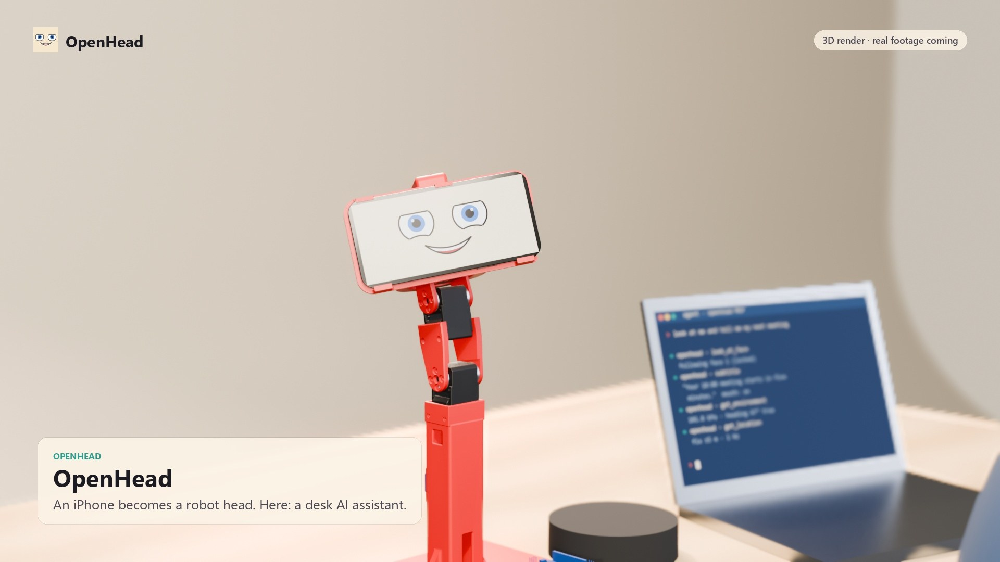
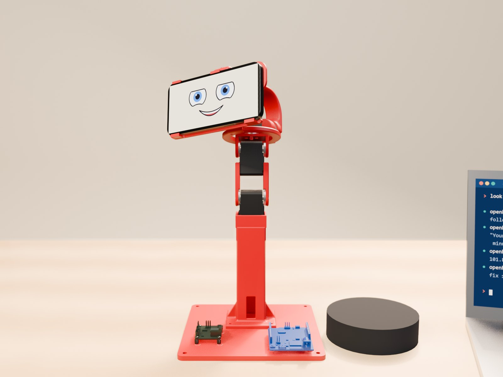
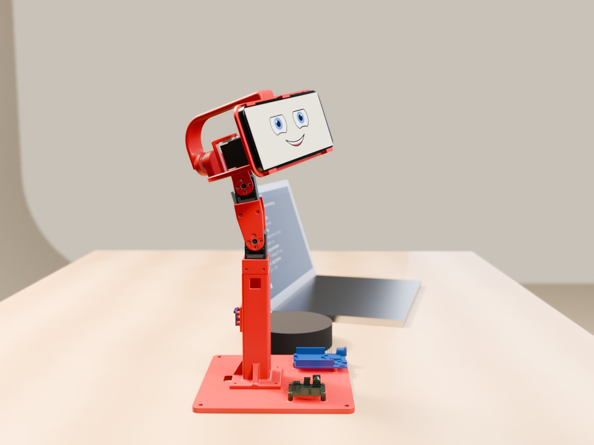
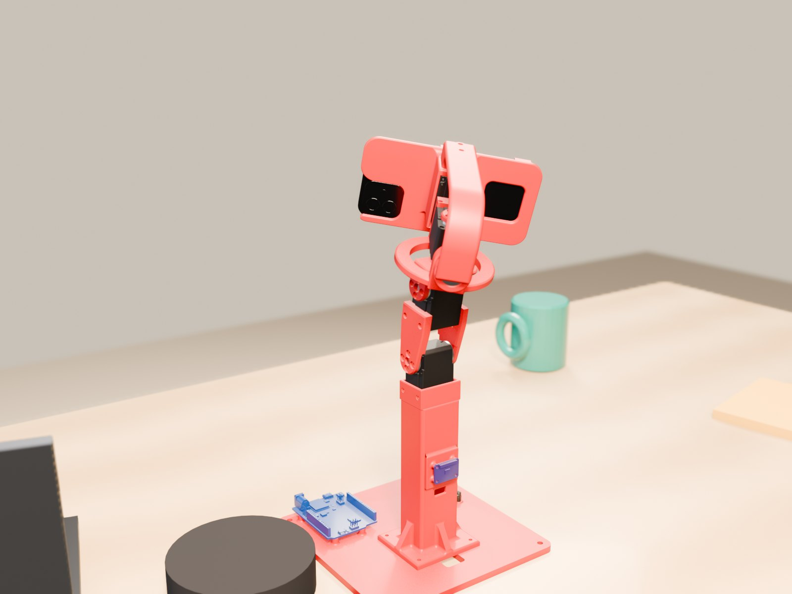

<p align="center">
  
</p>

<h1 align="center">OpenHead desk body</h1>

<p align="center"><strong>An iPhone on a four-servo neck: a desk AI assistant that looks at you.</strong></p>

<p align="center">
  <a href="https://patrikbichis.github.io/openhead-desktop-body/">Website</a> ·
  <a href="https://patrikbichis.github.io/openhead-desktop-body/sv/">På svenska</a> ·
  <a href="https://github.com/PatrikBichis/openhead">OpenHead (the face app)</a> ·
  <a href="#bill-of-materials">Bill of materials</a> ·
  <a href="#use-it-from-an-ai-agent">MCP server</a>
</p>

<p align="center">
  <a href="docs/media/desk-assistant.mp4"></a>
</p>
<p align="center"><a href="docs/media/desk-assistant.mp4">Watch the 3D render (with sound, 55 s)</a>: it follows a face, listens and answers in its own voice, and streams its sensors to an agent. Video of the real rig comes next.</p>

The phone runs [OpenHead](https://github.com/PatrikBichis/openhead): the face, the cameras, face tracking, ARKit, GPS and the other sensors, all over Wi-Fi. This repository is the body under it: printed parts, a neck with four Feetech servos, an Arduino Uno R4 WiFi that drives them, and Python with a CLI and an MCP server, so an AI agent can turn the head, nod, shake it and follow the person in front of it.

**The neck is [Open Duck Mini v2](https://github.com/apirrone/Open_Duck_Mini)'s neck**, unchanged in its kinematics and printed from Open Duck's own files, with a new head that holds a phone instead of Open Duck's head, a tower that holds the neck like the duck's body does, and a base for the electronics. Thanks to Antoine Pirrone and the Open Duck Mini contributors.

## What it does

| | |
|---|---|
| **Looks at you** | The phone finds your face (front camera); the neck turns so you stay in the middle while the eyes on screen follow you |
| **Gestures** | Nod, shake, tilt, look anywhere: yaw ±100°, pitch −20…+35°, roll ±25° (joint limits are wider) |
| **AI agent ready** | Two MCP servers side by side: `openhead` for the face and sensors, `openhead-body` for the neck |
| **Safe by default** | The Uno releases the servos when commands stop for 150 ms (watchdog), starts from where the servos are, limits each step and has an emergency stop |
| **Sees in two directions** | OpenHead uses the front and back camera at once (ARKit): world tracking behind, your face in front |

## Bill of materials

| Qty | Part | Notes |
|---|---|---|
| 4 | **Feetech STS3215** serial bus servo + horn | The SO-101 follower arm's servo (7.4 V, 1/345 gear). The neck also works with 1/191 or 1/147 |
| 1 | **Arduino Uno R4 WiFi** (ABX00087) | Drives the servo bus; USB to the computer (Wi-Fi later) |
| 1 | **Waveshare Bus Servo Adapter (A)** | Serial servo board, jumper in mode B, on four M2.5 × 6 standoffs in the base |
| 1 | **Adafruit BNO085** 9-DoF IMU (product 4754) | On the back of the tower as the body's reference; Qwiic (STEMMA QT) to the Uno, address 0x4A |
| 1 | **iPhone 12** or newer, with [OpenHead](https://github.com/PatrikBichis/openhead) | Mounted in landscape, screen forward |
| 1 | Ball bearing 608ZZ (8 × 22 × 7) | Rear support of the roll axis, in the rear arch |
| 1 | Power supply 7.4 V, 3 A or more | Into the adapter's DC jack; add a 470–1000 µF capacitor and a fuse |
| 1 | Qwiic / STEMMA QT cable | BNO085 to the Uno |
| – | 3 jumper wires | Adapter TX → Uno pin 0, adapter RX → Uno pin 1, GND |
| 8 | M2 × 8 screws | 4 for the neck servo in the tower, 4 for the roll servo in the phone holder |
| 6 | M3 × 12–16 screws, 4 M3 nuts | 4 tower ↔ base, 2 rear arch ↔ phone holder |
| 4 + 8 | M3 × 6 and M2.5 × 6 screws | Uno and servo board (4 into the standoffs from below, 4 through the board) |
| – | Open Duck Mini neck screws | As in Open Duck's assembly guide (neck sheets and servo horns) |
| 1 | Speaker, optional | Bluetooth to the phone; the render shows a Jabra Speak 510 |

## Printed parts

All files are in [`hardware/print`](hardware/print), in the rig's coordinates (mm, x forward, y left, z up, desk at z = 0), so they line up when imported together. Turn them in the slicer.

| File | Qty | Source | Notes |
|---|---|---|---|
| `base.stl` / `.step` | 1 | new | 180 × 180 × 12 mm, holds the Uno and the servo board, nut traps for the tower, 4 holes for a desk clamp. PLA about 130 g |
| `tower.stl` / `.step` | 1 | new | Holds the neck-pitch servo like Open Duck's body; cable channel, IMU plate on the back. About 63 g |
| `phone_holder.stl` / `.step` | 1 | new | Cage for the roll servo and the frame for the phone. About 32 g |
| `rear_arch.stl` / `.step` | 1 | new | Arch behind the neck with the 608ZZ seat. About 23 g |
| `head_yaw_to_roll_bearing.stl` | 1 | Open Duck, changed | Open Duck's `head_yaw_to_roll` with a printed Ø7.9 pin for the 608ZZ. 4–5 walls, 100 % infill around the pin |
| `neck_left_sheet.stl`, `neck_right_sheet.stl`, `head_pitch_to_yaw.stl` | 1 each | Open Duck, unchanged | Open Duck Mini v2's own print files |
| `tpu_corner_*.stl`, `tpu_rear_pad.stl`, `tpu_foot_pad.stl` | 4 + 1 + 1 | new, optional | TPU bumpers for the phone's corners, a rear pad and a non-slip foot |
| `zero_jig_neck_pitch.stl` | 1 | tool | Jig that sets the neck-pitch zero (calibration) |

The whole rig as one STEP assembly, grouped into stand, neck, head and beside it: [`hardware/assembly/desk_body_assembly.step`](hardware/assembly/desk_body_assembly.step) (21 MB; works in Shapr3D, Fusion, FreeCAD). The neck parts in it are Open Duck's meshes turned into solids: fine to look at, not to measure.

<p>
  
  
  
</p>

## Wiring

```
computer ──USB──> Uno R4 WiFi ──Serial1 (pins 0/1)──> Waveshare adapter (mode B) ──bus──> 4 × STS3215
                       └──Qwiic──> BNO085                      └── 7.4 V supply
```

- Adapter jumper in **mode B**. Adapter TX → Uno pin 0 (RX), adapter RX → Uno pin 1 (TX), GND → GND.
- **Check first** that the adapter's UART tolerates the Uno's 5 V logic: measure its TX at rest. If it idles at 3.3 V and the input is not 5 V tolerant, put a level shifter on Uno TX → adapter RX.
- Servo power 7.4 V into the adapter. The Uno runs from USB; do not feed VIN from the servo bus at the same time.
- Servo IDs follow Open Duck's numbering: neck pitch 30, head pitch 31, head yaw 32, head roll 33.

## Firmware

Two sketches for the Uno R4 WiFi in [`firmware`](firmware) (Arduino IDE: board *Arduino UNO R4 WiFi*):

| Sketch | For |
|---|---|
| `servo_setup` | **First:** find the servos, give them their IDs, configure them and drive them to the middle (2048) before the horns go on. A text menu in a serial terminal at 115 200 baud |
| `body_uno` | The body's firmware: a small binary protocol over USB, 50 Hz control with watchdog, step limit and emergency stop; reads the BNO085 |

```bash
arduino-cli compile --fqbn arduino:renesas_uno:unor4wifi -u -p COM5 firmware/body_uno
```

The firmware comes from the Open Duck Mini bench work and still speaks the full robot's 14-joint protocol; the desk body uses the four neck joints. Its comments and the setup menu are in Swedish for now.

## Software

Python 3.12 with [uv](https://docs.astral.sh/uv/):

```bash
cd python
uv sync
uv run openhead-body --port fake look 30 10     # try it without hardware (a simulated Uno)
uv run openhead-body status                      # the real rig: first Arduino found, or --port COM5
uv run openhead-body look 30 10                  # yaw, pitch (and roll) in degrees
uv run openhead-body nod                         # nod | shake | tilt | home | relax
uv run openhead-body follow --phone 192.168.1.20 # turn towards the person the phone sees
uv run pytest -q                                 # 46 tests, against the simulated Uno
```

Or as a library:

```python
from openhead_body.neck import Neck

with Neck.open() as neck:          # "fake" simulates the Uno
    neck.look(yaw=25, pitch=10)    # degrees; returns when the move is done
    neck.nod()
```

Angles are in the head frame: **+yaw turns to the head's left, +pitch looks up, +roll tilts the top of the head to its left**, the same convention as OpenHead's `faces` stream, so a face's bearing is directly the yaw to turn. Pitch is shared between the neck and the head joints, whose axes are parallel. While the torque is on a thread sends the targets 50 times a second (the Uno's watchdog lets go after 150 ms of silence); moves follow a minimum-jerk profile.

Servo setup and calibration: `openhead-body-bench` (scan, IDs, registers, latency, watchdog test, single-joint moves) and `openhead-body-calib` (register audit, gear test, safe zeroing, and calibrating the neck with the phone's gravity vector). The step-by-step guide is in [`docs/calibration.sv.md`](docs/calibration.sv.md) (Swedish). The calibration is saved per rig in `~/.openhead-body/joints.json` (or `$OPENHEAD_BODY_JOINTS`).

## Use it from an AI agent

Run both MCP servers: OpenHead's for the face, the cameras and the sensors, and this one for the neck. Pair the phone once first: `openhead pair --device 192.168.1.20` (see [OpenHead's README](https://github.com/PatrikBichis/openhead#use-it-from-an-ai-agent)).

Claude Code:

```bash
claude mcp add openhead --scope user -- uvx --from "openhead[mcp] @ git+https://github.com/PatrikBichis/openhead@v0.3.0#subdirectory=python" openhead mcp --device 192.168.1.20
claude mcp add openhead-body --scope user -- uvx --from "git+https://github.com/PatrikBichis/openhead-desktop-body#subdirectory=python" openhead-body --phone 192.168.1.20 mcp
```

Claude Desktop, Cursor, Gemini CLI (`mcpServers`):

```json
{
  "mcpServers": {
    "openhead-body": {
      "command": "uvx",
      "args": ["--from", "git+https://github.com/PatrikBichis/openhead-desktop-body#subdirectory=python",
               "openhead-body", "mcp"],
      "env": { "OPENHEAD_DEVICE": "192.168.1.20", "OPENHEAD_BODY_PORT": "COM5" }
    }
  }
}
```

| Tool | Does |
|---|---|
| `look(yaw, pitch, roll, seconds)` | Point the head, degrees in the head frame |
| `gesture(kind, times)` | `nod`, `shake` or `tilt` |
| `home()` / `relax()` | Look straight ahead / torque off |
| `follow_face(on)` | Turn towards the person the phone sees; the eyes follow too |
| `move_joint(joint, degrees)` | One neck joint, for tests and calibration |
| `status()` | Pose, joint angles, servo load, bus voltage, alarms |

Then ask: *"Look at me, and nod if you can see me."* or *"Follow my face and tell me when I leave."*

## Status

The rig is printed and assembled. The firmware and the bench tools come from Open Duck Mini bench work and are tested against a simulated Uno here; on the real rig, still to check: the adapter's 5 V tolerance, the Uno's USB bridge at 460 800 baud, the direction and zero of each joint (calibration), and the BNO085 axes. The 3D render shows what the desk body is for; video of the real one comes when it all works.

## Repository layout

```
hardware/print/       STL and STEP files to print (see the table above)
hardware/assembly/    the whole rig as one STEP assembly
hardware/images/      renders of the rig (Blender and MuJoCo), the phone fit, the TPU bumpers; joint_sweep.mp4
firmware/             servo_setup and body_uno for the Uno R4 WiFi
python/               openhead_body: neck control, face following, CLI, MCP server, bench and calibration tools, tests
docs/                 the website (GitHub Pages), the calibration guide
```

## License and credits

Apache License 2.0, see [LICENSE](LICENSE) and [NOTICE](NOTICE).

- **[Open Duck Mini v2](https://github.com/apirrone/Open_Duck_Mini)** by Antoine Pirrone and contributors (Apache 2.0): the neck design, its printed parts, servo positions and joint limits. The neck sheets and `head_pitch_to_yaw` are Open Duck's files unchanged; `head_yaw_to_roll_bearing` is changed (a pin for the bearing).
- **[SO-ARM100 / SO-101](https://github.com/TheRobotStudio/SO-ARM100)** by TheRobotStudio (Apache 2.0): the STS3215 and Waveshare adapter models in the assembly.
- **[OpenHead](https://github.com/PatrikBichis/openhead)**: the face, the cameras and the sensors on the phone.
